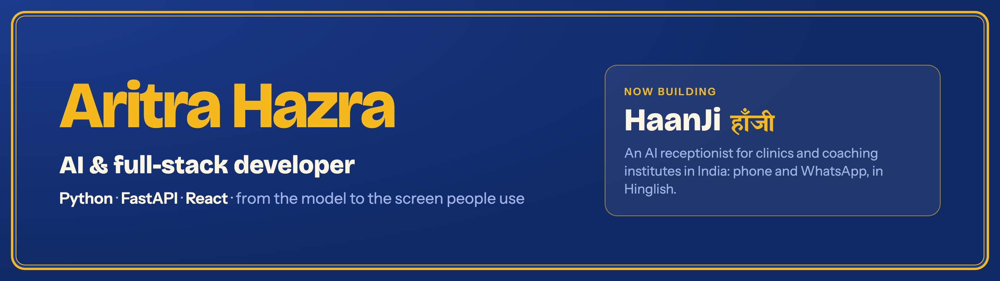

I build AI products end to end: the model calls, the API behind them, and the
screen people actually use. I care about systems that can show their work:
tests for every claim, and numbers that come from code someone can run.

## Featured project

<table>
  <tr>
    <td width="46%">
      
    </td>
    <td>
      <h3><a href="https://github.com/aritra-25hazra/haanji">HaanJi हाँजी</a></h3>
      An AI receptionist for clinics and coaching institutes in India. It answers
      the phone and WhatsApp in Hinglish, books the right doctor or class, runs the
      token queue at reception, and can prove afterwards what the caller agreed to.
      <ul>
        <li><b>Bhasha Bridge</b>: repairs misheard names by how they sound</li>
        <li><b>Speculative turns</b>: looks up the answer while the caller is still speaking</li>
        <li><b>Pramaan ledger</b>: every booking sealed in a signed, hash-chained receipt</li>
      </ul>
      
<i>Made with Prabhav Upadhayay and Anuj Uniyal.</i>

      <a href="https://haanji-engine.onrender.com/talk"><b>Talk to it</b></a> ·
      <a href="https://haanji-kappa.vercel.app"><b>Console</b></a> ·
      <a href="https://github.com/aritra-25hazra/haanji"><b>Code</b></a> ·
      <a href="https://github.com/aritra-25hazra/haanji/blob/main/research/REPORT.pdf"><b>Report</b></a>
    </td>
  </tr>
</table>

## Tech I work with

  

  
  
  
  
  

